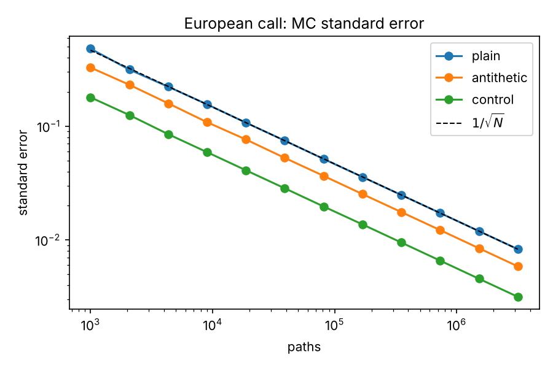

# Monte Carlo Option Pricer

Monte Carlo pricing engine for vanilla and path-dependent options under geometric Brownian motion,
with variance reduction, Monte Carlo Greeks and a C++ engine. Every Monte Carlo result is checked
against a closed-form benchmark.

## Results

All numbers come from `python run_experiments.py` (saved in `results/results.json`).
Base case: S = 100, K = 100, T = 1y, r = 5%, sigma = 20%.

| Test | Benchmark | Result |
|---|---|---|
| European call, 1M paths, 40 seeds | Black-Scholes 10.4506 | Control variate: mean abs error 4.6 bp |
| Pricing grid, 90 contracts (5 strikes x 3 maturities x 3 vols x call/put) | Black-Scholes | Mean abs error 0.009, 98% within 2 standard errors |
| Variance reduction, same path budget | Plain MC | Antithetic 2.0x, control variate 6.9x lower variance |
| Arithmetic Asian call, 252 daily fixings | Geometric Asian (closed form) as control | Variance cut ~1,300x (SE 0.0179 to 0.0005) |
| Up-and-out call, B = 130, weekly monitoring | Continuous-barrier closed form 3.333 | Naive MC biased +14.1%; Brownian bridge fixes it to -0.3% |
| Greeks (delta, vega, gamma), 1M paths | Analytic Black-Scholes Greeks | All within 0.13% |
| C++ engine, 10M antithetic paths | Black-Scholes | Under 200 ms, abs error 0.004 |



Standard error falls as 1/sqrt(N) for all three estimators; variance reduction shifts the line down
without changing the slope.

## Methods

- **Paths:** exact GBM discretisation, `S_t = S_0 exp((r - sigma^2/2) t + sigma W_t)`, vectorised in NumPy.
- **Antithetic variates:** pair each draw `z` with `-z`.
- **Control variate (European):** discounted terminal stock, whose expectation under Q is known; optimal
  coefficient `b = Cov(payoff, control) / Var(control)`.
- **Control variate (Asian):** geometric-average Asian, priced exactly (Kemna-Vorst, discrete fixings).
- **Barrier:** discrete monitoring misses crossings between dates. The Brownian-bridge correction multiplies
  each path by the probability it did not cross between monitoring dates:
  `p = exp(-2 ln(B/S_i) ln(B/S_{i+1}) / (sigma^2 dt))`.
- **Greeks:** delta and vega by pathwise derivative; gamma by central finite difference with common random numbers.

## Layout

```
pricer/analytic.py   Black-Scholes price and Greeks, geometric Asian closed form
pricer/mc.py         European, Asian and barrier Monte Carlo, Greeks
cpp/mc_european.cpp  C++ European pricer (antithetic, mt19937_64)
run_experiments.py   Reproduces every number above
results/             results.json, convergence.png
```

## Run

```
pip install numpy scipy matplotlib
g++ -O3 -march=native -o cpp/mc_european cpp/mc_european.cpp
python run_experiments.py
```

## Limits

GBM with constant volatility and rates: no smile, jumps or stochastic vol. A natural next step is
Heston or local volatility, and pricing autocallables or other structured payoffs on top of the same engine.
